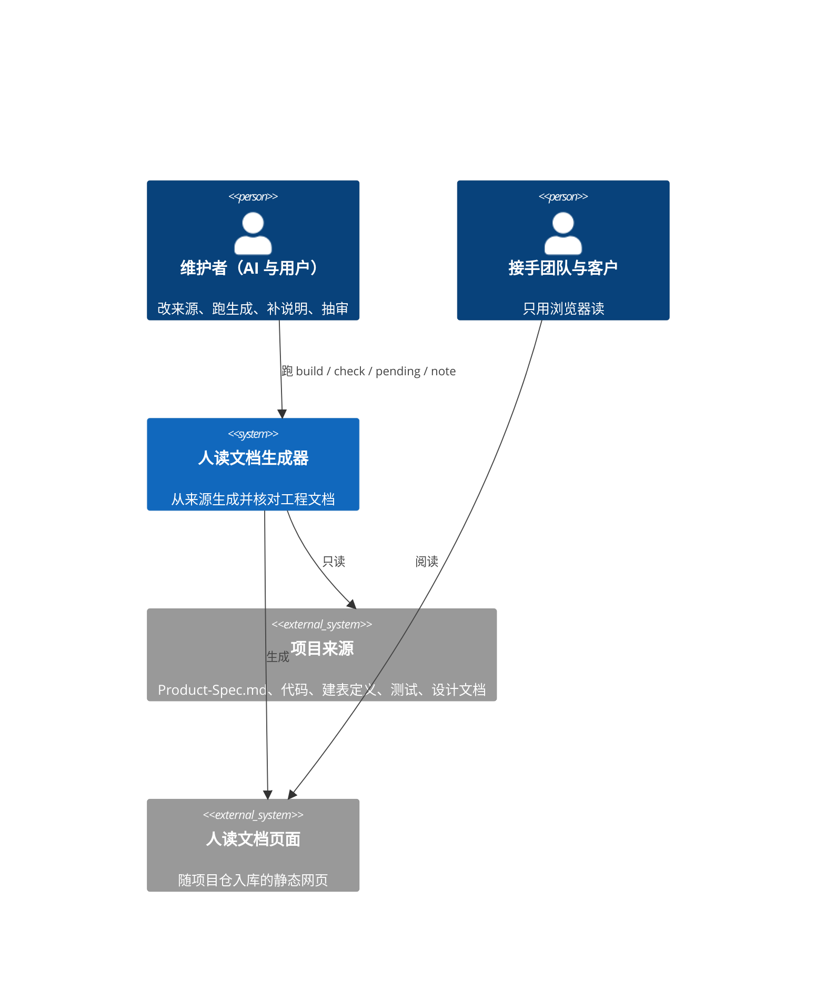
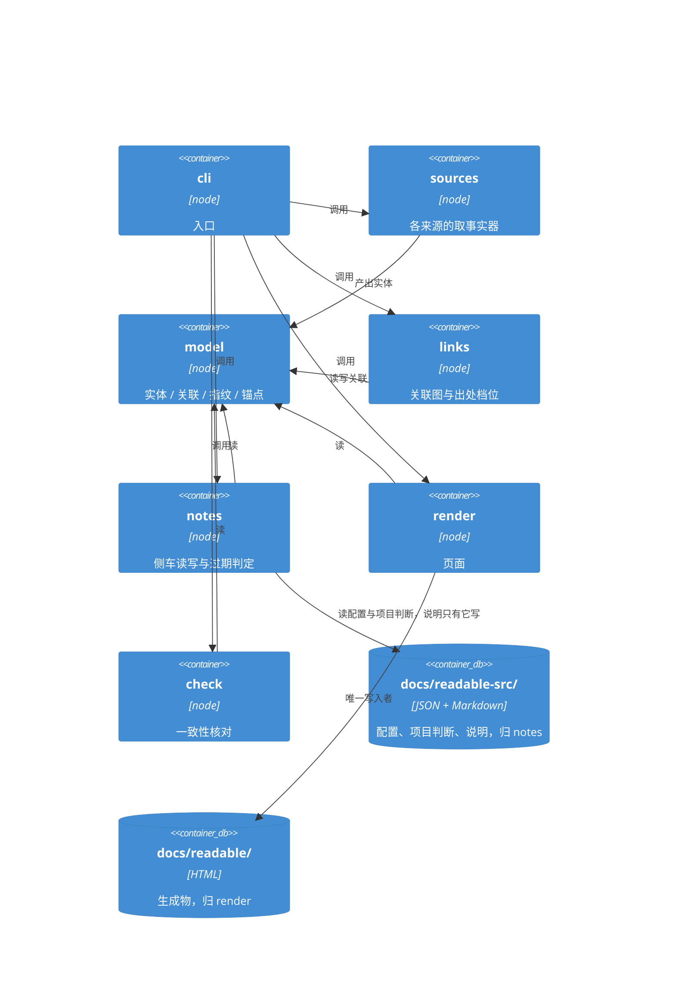
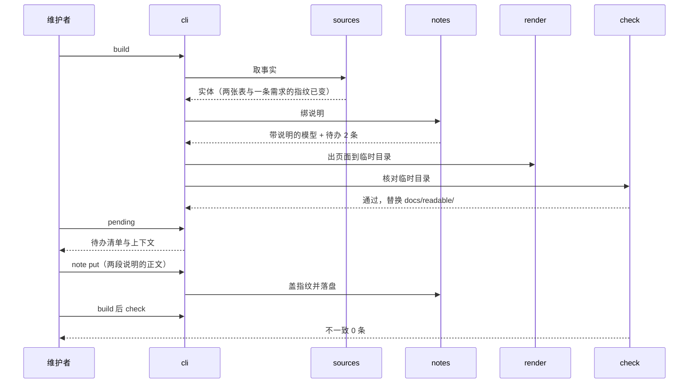

# Architecture Design — 人读文档

> 生成：2026-11-22 · 档位：M · 路：Fast（用户「你来定」，推断处标 `[假设]`）· 状态：待批准
> 需求来源：docs/readable-spec/Product-Spec.md v1.0。本文档只写不变量（两个独立构建的单元会在这上面选得不兼容的决定），其余是种子，代码一出现就归代码。
> 本稿已并入第二个模型独立出的骨架，对照结论见 §16。

## 1. 架构概览

- **架构风格与命名范式**：管道过滤器。四段管道——取事实 → 连关联并绑说明 → 出页面 → 核对；段与段之间只靠一份「文档模型」传话。层到目录的映射：`sources/` 取事实，`links` 与 `notes` 连关联绑说明，`render/` 出页面，`check` 核对（被拒备选：外部 docs-as-code 工具、全程由 AI 直接写，理由见 ADR-1）
- **技术栈**：

| 名称 | 版本 | 角色 |
|---|---|---|
| Node.js 内置模块 | 与框架现有脚本同（CI 跑 22 与 24） | 生成器全部代码，不引第三方依赖 |
| 静态 HTML + 内联 SVG + 少量内联脚本 | — | 产物；浏览器直接打开，不联网 |

- **一句话数据流**：来源（Product-Spec.md、建表定义、代码、测试、设计详述、架构文档与决策记录、业务口径）被各自的取事实器读成文档模型 → 连成关联图，绑上侧车里的说明 → 渲染到临时目录 → 核对通过后整目录换上。build 全程机械、不调 AI，同样的来源两次生成逐字节相同。
- **系统上下文（C4 L1）**：



## 2. 模块划分

| 模块 id | 职责（一句话） | 对外契约 | dependsOn | 禁依赖 | 变化原因（SRP 检验） | riskTier | 设计详述 |
|---|---|---|---|---|---|---|---|
| sources | 把一种来源读成实体，每种来源一个取事实器：Markdown 切块、建表定义、代码扫描、测试扫描 | `extract(配置) → 实体` | model | links、notes、render、check | 来源的写法变了、要支持新语言或新格式 | high | 无 |
| model | 文档模型：实体、关联、指纹、锚点的定义与归一 | 数据形状 | — | 其余全部 | 文档要多讲一类东西 | high | 无 |
| links | 把实体连成关联图，每条边带出处档位 | `link(实体, 项目判断) → 关联图` | model | render、check | 关联的推法变了 | high | 无 |
| notes | 读项目配置与项目判断；说明的唯一写入者：给说明盖指纹，判现行、待更新、孤儿 | `bind(模型) → 带说明的模型 + 待办清单`；`put / confirm / drop` | model | sources、render | 说明的存法或绑定规则变了 | high | 无 |
| render | 把带说明的模型出成页面 | `render(模型) → 临时目录` | model | sources、notes 的内部 | 版式与切分方式变了 | medium | 无 |
| check | 重新取事实，再从产出的页面里反读内容，两边比对出不一致清单 | `check(根) → 不一致清单` | sources、model、notes | render 的任何中间结果 | 「一致」的定义变了 | high | 无 |
| cli | 一个入口串起各段 | `init` / `build` / `check` / `pending` / `note put` / `note confirm` | 全部 | — | 用法变了 | low | 无 |

- **容器图（C4 L2，图即规则：谁可依赖谁）**：



## 3. 依赖规则

- **分层**（外 → 内，依赖只许向内）：cli → sources / links / notes / render / check → model
- **禁边**：render ✗→ sources（页面只认模型）；check ✗→ render 的中间结果（核对器自己重新取事实、自己从页面反读，否则渲染器吞了字它看不见）；sources ✗→ notes（事实不许掺 AI 的话）；任何模块 ✗→ 写来源文件
- **数据所有权**：`docs/readable/` 只有 render 写，先写临时目录、核对通过再整目录替换；`docs/readable-src/notes/` 只有 notes 写——说明的正文由 AI 交给 `note put`，指纹由命令按当前来源盖上，AI 碰不到指纹；同目录下的 `config.json` 与 `map.json` 是人和 AI 直接编辑的配置，生成器只读、只校验；来源文件生成器永不写

## 4. 一致性约定

| 关注点 | 约定（独立构建者会各写各的那些默认） |
|---|---|
| 命名（实体 / 文件 / 接口 / 事件） | 实体锚点是「类别:名字」：`table:raw_rows`、`column:raw_rows.session_id`、`module:<项目判断里的模块名>`、`rule:<设计详述的规则号>`、`test:<文件>::<用例名>`。需求块的锚点按序取第一种能用的：显式编号（`req:REQ-DOC-001`）→ 章节路径加条目开头的粗体词（`spec:功能需求/登录`）→ 章节路径加它在本章里的序号（`spec:功能需求#12`）；重了的在后面接 `~2`。页面地址由锚点推出，同一个锚点永远落在同一个地址；需求规格是例外的一半——条目的 `id` 由锚点推出、不随别处增删而变，章的页面却按章的序号命名（与清单页上写的章号一致），中间插进一章后面的地址会后移 |
| 数据与格式（id / 日期时间 / 金额 / 错误形状 / 响应信封） | 指纹 = 切片规范形的 SHA-256 前 12 位。规范形：Markdown 块是换行统一、行尾空白去掉的文本；表是合并 CREATE 与 ALTER 之后的结构（列序、类型、空值、默认值、约束、外键、索引、紧贴的源码注释）；列是它自己的定义；模块是排序后的文件清单加对外接口与依赖，函数体不计入。所有输出按锚点排序；编码 UTF-8、换行 LF |
| 状态与横切（变更方式 / 错误处理 / 日志 / 配置 / 鉴权） | 页面上每段内容标出处，四选一：「取自来源」「来源里的注释」「旧文档（出处与日期）」「说明（草稿 / 已抽审 / 待更新）」。关联的出处档位四选一：机械推出 / 来源里声明 / AI 提议 / 人已确认；经中间实体传递得到的另标「间接」。说明的指纹对不上就原文照显并加「待更新」横条。退出码与 design-trace 一致：0 一致、1 有不一致、2 用法错、3 脚本自身出错 |

## 5. 扩展点（开闭原则落点）

| 易变轴 | 扩展机制 | 新增一种时改哪 |
|---|---|---|
| 来源的种类与语言（建表定义的方言、Python / TypeScript 的引用关系、测试框架） | 取事实器注册表，每个只管一种来源 | `sources/` 下加一个文件并登记 |
| 文档的种类（数据库、架构、设计、需求、测试、指南、业务入门；以后的 UI、可信、DFX） | 渲染器按文档种类分文件，共用版式件 | `render/` 下加一个文件 |

只为规格已确认的两条轴留位；别的不预留。

## 6. 关键场景走查

### 场景 1：AI 改了一条需求和两张表之后（规格 FLOW-2）
build 重新取事实：那条需求的指纹变了，两张表的指纹变了。notes 发现挂在这两张表上的说明指纹对不上，列进待办；render 把新的字段表与需求原文写进页面，旧说明带「待更新」横条。`pending` 把待办连同每项的上下文交给 AI，AI 重写两段说明，经 `note put` 落盘、由命令盖上新指纹。再 build，横条消失；check 报不一致 0 条。



### 场景 2：需求规格零丢失怎么守
sources 把 Product-Spec.md 切成块：标题、顶层列表项连同续行与子项、表格行、段落、引用段、围栏。render 逐块输出。check 不读 render 留下的任何记录：它自己从 Spec 重切一遍，再独立解析产出的页面、取每个块的文字，要求每个来源块恰好出现一次、顺序相同、文字相同，页面里也没有来源里找不到的块。对不上的点名到行。最容易吞字的地方进自测夹具：表格里的竖线、Spec 里内嵌的标签、超长行、嵌套列表。

### 场景 3：生成中途失败
render 写的是临时目录；写完由 check 核临时目录，通过才替换 `docs/readable/`。任何一步出错，临时目录丢弃，读者看到的仍是上一版，命令退出码非 0 并说明错在哪一份。

### 场景 4：建表定义里有静态读不出的部分
conflation 的 schema.sql 有 77 条 CREATE、117 条 ADD COLUMN，另有 17 个 `DO $$` 块，其中 16 个在运行时改表结构（2026-11-23 实数）。取事实器把 CREATE 与 ALTER 合并出现行结构；`DO $$` 块合并不了，就在数据库设计的页面上列出「这几处定义要到库里才生效，文档未包含」并带行号，不装作完整。

## 7. 运行与部署包络

| 项 | 三态 | 内容 / 回来定的条件 |
|---|---|---|
| 环境（本地 / 测试 / 生产） | 决定 | 维护者机器上跑（有 node 即可）；读者只需浏览器，可离线；CI 里可跑 check |
| 部署拓扑（单机 / 容器 / 多实例） | 决定 | 无服务；产物是随仓入库的静态文件 |
| 基础设施与供应商（云 / 内网 / 数据库托管） | 决定 | 不用任何外部服务；不连数据库，表结构只从建表定义的文本里读 |
| 运维（日志 / 监控 / 备份 / 发布与回滚） | 决定 | 备份与回滚靠 git；生成与核对的结果打到终端；不设监控；提交前检查自动重出页面（见 §8） |

## 8. 关键决策记录（ADR）

| 已定但够不上 ADR 的 | 结论 | 一句理由 |
|---|---|---|
| 存储 | 文件：生成物与侧车都在项目仓里 | 读者没有任何运行环境，没有真备选 |
| 模块间通信 | 进程内函数调用，传文档模型对象 | 一个命令跑完，没有跨进程的理由 |
| 表结构从哪读 | 建表定义的文本，不连真库；读不出的部分明示 | 生成器要能在任何一台机器上离线跑 |
| 算法规则从哪来 | 只投影设计详述（docs/design/）；没有设计详述的模块只出机械骨架并写明「规则未成文」，要补就走设计详述的流程 | 让 AI 把从代码猜出的规则写进说明，会让推断冒充事实，还会和设计详述形成两份真相 |
| 代码扫描做到哪 | 四件事：字符串里的 SQL 对已知表名的写与读、import 行、路由与前端对路由的引用、数据结构的字段 | 不做调用图与逐函数文档；通用代码分析器是个无底洞 |
| 什么时候写 | 边开发边写：提交前检查自动重出页面，任务验收里由改代码的人补齐说明并核对到 0 条，阶段收尾再核对一次 | 事后补只能靠重读代码去猜；用户 2026-11-23 定，取代原先「等真漏一次再加提醒」的押后 |
| 页面上写不写代码行号 | 不写；建表定义文件的行号照写 | 代码一改行号就挪，入库的页面每次提交都带一批没有内容的差异 |

### ADR-1：管道加文档模型，而不是用现成工具或让 AI 直接写
- **状态**：accepted
- **背景与问题**：要给 AI 写出来的项目出一整套人读文档，并且保证与来源同步、需求规格一字不丢。conflation 两周后交接，接手团队没有 Claude，也不会装任何工具。
- **决策驱动**：同步与零丢失必须能由机器核对；读者零依赖；不许为出文档改 Product-Spec.md 的写法；框架脚本不引第三方依赖。
- **候选与优劣**：
  - 管道加文档模型：好——每段可单独核对，事实与说明天然分开；坏——取事实器要自己写，每种语言一个。
  - 外部 docs-as-code 工具（Sphinx-Needs、StrictDoc 这类）：好——追溯与矩阵是现成的；坏——要把需求改写成它的格式，要装 Python 工具链，违反三条硬约束。
  - 每次让 AI 直接写全套文档：好——上手最快；坏——零丢失与同步无法核对，每次全量重写烧 token，过期了没人知道。
- **决策**：选管道加文档模型，因为只有它能让「同步」与「不丢」变成可核对的事实。
- **后果**：好——AI 只写说明，其余全是机械的；坏——首批要写建表定义、代码扫描、测试扫描三个取事实器（记进 §11）。
- **被拒备选与理由**：外部工具——要改 Spec 的写法；AI 直写——核对不了。
- **执法方式**：人工评审；建成后由生成器自带的核对命令在替换页面之前跑。
- **revisit-if**：出现一个不要求改写来源、零依赖就能出静态页面的成熟追溯工具；或者下游项目的语言多到取事实器写不过来（超过五种）。
- **reversal**：侧车里的说明是纯 Markdown，可以原样带走；丢掉的是取事实器与渲染器，重选工具约一到两周。

### ADR-2：AI 写的说明放侧车，只能经命令落盘，由命令盖指纹
- **状态**：accepted
- **背景与问题**：表的用途、字段的含义、模块的职责只有 AI（或原作者）写得出来；来源一变它们就可能过期，而读者分不出哪句还算数。
- **决策驱动**：过期必须自动暴露，而且不能被写说明的一方绕过；不能每次全量重写；事实与解释要分得开；离交接两周，不能大面积动代码。
- **候选与优劣**：
  - 侧车文件，正文经 `note put` 落盘、指纹由命令按当前来源盖：好——来源变了自动标过期，AI 没法把旧说明冒充成现行，锚点不存在的直接拒收，只重写变了的那几段；坏——接手之后没人跑生成器，侧车就不再更新。
  - AI 直接编辑侧车文件，自己写指纹：好——少一个命令；坏——指纹可以被照抄，过期判定形同虚设。
  - 直接写在生成的页面里：好——简单；坏——重新生成即被覆盖。
  - 写回来源（建表定义里的注释、代码里的文档串）：好——说明跟着代码走；坏——交接前两周要改动上百张表和几百个文件，而且是在别的机器上正在开发的代码。
- **决策**：选侧车加命令盖指纹；每段说明带状态「草稿 / 已抽审」，人抽审后由 `note confirm` 改状态。
- **后果**：好——增量便宜，过期不可伪造；坏——交接后说明与代码会渐行渐远（规格已定为不管，见 OUT-1）。
- **被拒备选与理由**：自己写指纹——可伪造；写进页面——与「可重复生成」矛盾；写回来源——现在动代码的风险大于收益，留作交接时的一次性选项（§9）。
- **执法方式**：人工评审；建成后由核对命令报「待更新说明」与「孤儿说明」两项。
- **revisit-if**：接手团队明确要求说明写在代码注释里；或者项目进入长期由人维护、不再由 AI 开发的阶段。
- **reversal**：把侧车内容按锚点灌进对应的代码注释，一次性脚本，约两天；灌回去之后就不再有指纹绑定。

### ADR-3：生成的页面随项目仓入库
- **状态**：accepted
- **背景与问题**：读者没有框架、没有 node，拿到仓库就要能看；而页面是生成物，入库会带来大块的差异和多台机器之间的合并冲突。
- **决策驱动**：读者零依赖；「指不定其实人在看」——仓里的页面不能落后；仓库体积不能再失控。
- **候选与优劣**：
  - 入库：好——拉仓即看，提交历史里文档与来源同步前进；坏——每次生成有差异要提交，两台机器各自生成会冲突。
  - 不入库，交接或发版时才生成：好——仓库干净；坏——平时没人看得到现行文档，交接那天才第一次暴露问题。
- **决策**：选入库，输出逐字节确定，冲突时以重新生成为准、不手工合并。
- **后果**：好——随时可读；坏——仓库多出一批生成文件，每次重出有差异要提交（记进 §11）。
- **被拒备选与理由**：不入库——与「及时同步」「有人在看」不符。
- **执法方式**：人工评审；建成后由核对命令比对页面与现行来源。
- **revisit-if**：生成物让仓库体积涨得比来源还快；或者读者改为从一个发布出去的地址看文档。
- **reversal**：把 `docs/readable/` 加进忽略清单并从仓里移除，改在交接流程里生成，半天。

### ADR-4：关联先靠机械推出，推不出的由 AI 提议、人确认，再没有就明示「未关联」
- **状态**：accepted
- **背景与问题**：读者要从需求找到模块、文件、表、测试。新格式的 Spec 有需求编号；conflation 的老 Spec 只有 12 条编号，功能需求是三十来条粗体词开头的长条目，而规格禁止为出文档去改 Spec。
- **决策驱动**：不许改 Spec；关联错了比没有更糟；每条关联要说得出依据。
- **候选与优劣**：
  - 分档：机械推出（文件属于哪个模块、文件写读哪张表、外键、路由到处理文件、规则到测试的标签）→ 来源里声明的（设计详述「来源」栏引的需求或口径）→ AI 对着候选清单提议 → 人抽样确认；都没有写「未关联」。好——每条边带档位，读者知道该信几分；坏——老项目的需求一侧首批多是「AI 提议」或「未关联」。
  - 全靠 AI 声明、不分档：好——看起来全；坏——无从核对。
  - 先给老 Spec 补齐编号：好——之后都能机械推；坏——违反「不为出文档改 Spec」。
- **决策**：选分档；需求块的指纹变了，挂在它上面的 AI 提议与人确认的关联标「待复核」，不删。
- **后果**：好——可核对、可逐步变实；坏——conflation 的需求到代码这一侧首批比较稀（记进 §11）。
- **被拒备选与理由**：不分档的声明——不可核对；补编号——规格禁止。
- **执法方式**：人工评审；建成后由核对命令报「关联指向不存在的实体」。
- **revisit-if**：用户同意在某个项目的 Spec 上补编号；或者实测某类机械推出的关联错误率高到读者被误导。
- **reversal**：关联只是模型里的一类关系，换推法只改 links 与对应的取事实器，约两到三天。

## 9. 押后决定（Deferred）

| 决定 | 为什么可以等 | 什么条件下回来定 |
|---|---|---|
| 交接时要不要把说明一次性灌回代码注释 | 不影响现在的生成与核对 | conflation 交接前一周，由用户定 |
| 拿真库导出的结构文件做对照 | 静态合并读不出的部分先明示出来 | 明示的清单让读者误判表结构时 |
| 外文版、Word / PDF 套版、页内搜索 | 规格列在「以后」 | 客户审核前或读者反馈找不到 |
| 从 ORM 模型类取表结构、调用图 | 手上三个下游都有建表定义文本 | 遇到只有模型类的项目 |
| AI 另画的示意图 | 能从结构画的图先顶上 | 结构图不够用、用户点名要 |
| 每类文档的章节细目与版式 | 不会让模块之间不兼容 | 数据库小样给用户看过之后 |

## 11. 风险与技术债

| 风险 / 债 | 来源（ADR / 押后） | 回收条件 |
|---|---|---|
| 取事实器按语言各写一个，首批三个 | ADR-1 | 第二个下游项目接入时复用率低于一半就回头看 |
| 「谁写谁读」从字符串里的 SQL 推出；conflation 有 8 处动态拼出的表名推不到 | ADR-4 | 页面列出「未解析」清单；由项目判断补归属 |
| 指纹粒度定错：绑整个文件会天天全标「待更新」，绑得过细说明数量爆 | §4 | 小样上数一周内被标过期的说明条数，过多就调规范形 |
| 关系图自动排布容易超支 | §5 | 每组最多 12 张表，简单分层排布，不追求好看 |
| 首批说明量大：conflation 约一百张表、几十个模块 | ADR-2 | `pending` 每项只给约 4KB 上下文、按页分批；外键列的含义机械给出不交给 AI |
| 交接后侧车不再更新 | ADR-2、规格 OUT-1 | 用户已定不管 |
| 生成物入库增大仓库、带来差异噪音 | ADR-3 | 见 ADR-3 的 revisit-if |

## 12. 目录结构骨架

```
框架仓（随框架分发）
.claude/scripts/readable-docs.mjs      入口
.claude/scripts/readable/model.mjs
.claude/scripts/readable/sources/      md-blocks / sql-ddl / code-scan / tests-scan
.claude/scripts/readable/links.mjs
.claude/scripts/readable/notes.mjs
.claude/scripts/readable/render/       每类文档一个文件，加共用版式
.claude/scripts/readable/check.mjs
.claude/skills/readable-docs/          什么时候跑、待办怎么补、说明怎么写

装了框架的项目里
docs/readable/                         生成的页面（入库，不手改）
docs/readable-src/config.json          来源在哪：建表文件按执行顺序、代码根、测试规则、Spec 路径、忽略项
docs/readable-src/map.json             项目判断：细分模块表、表的分组、动态表名的归属、需求关联（提议 / 已确认）
docs/readable-src/notes/               AI 写的说明，一页一个文件
```

## 13. 术语表

| 术语 | 含义 | 与 Spec 的对应 |
|---|---|---|
| 来源 | 生成文档所依据的东西 | 同 |
| 文档模型 | 取事实之后、出页面之前的那份实体与关联 | Spec 未出现，属实现 |
| 锚点 | 一个实体的固定名字，说明与关联都挂在它上面 | Spec 未出现，属实现 |
| 项目判断 | 机械推不出、要 AI 提议并由人确认的归属：模块怎么分、表怎么分组、需求连到哪 | Spec 的「关联」里推不出的那部分 |
| 说明 | AI 写的解释，存在侧车里 | 「AI 写的说明」 |
| 指纹 | 一段来源内容的摘要，用来判断说明是否过期 | 「内容指纹」 |
| 待更新 | 说明所依据的来源已变而说明没重写 | 同 |
| 未关联 | 推不出也没人提议的关联 | 同 |

## 14. 七大原则自检记录

| 原则 | 结论 | 备注（过不了的写理由或整改项） |
|---|---|---|
| 开闭 OCP | ✅ | 新来源、新文档种类各加一个文件 |
| 依赖倒置 DIP | ✅ | 各段只依赖 model，不依赖彼此的实现 |
| 单一职责 SRP | ✅ | 每个模块一个变化原因，见 §2 |
| 接口隔离 ISP | ✅ | 取事实器只交实体；渲染器只读模型 |
| 迪米特 LoD | ✅ | render 不回头读来源，check 不读 render 的中间结果 |
| 里氏替换 LSP | ✅ | 任何取事实器产出的实体形状相同，可互换 |
| 合成聚合 CARP | ✅ | 各段由 cli 组合，没有继承 |

## 15. 演进路线（本版不做但已预留）

- 第一期：数据库设计（建表定义的合并、代码里的写读、表的分组与关系图、说明与指纹、原子落盘、核对）。
- 第二期：架构（模块表、依赖、路由、旧架构文档与决策记录带日期摘录）与人读版需求规格（逐块投影、四类结构图、零丢失核对）。
- 第三期：算法设计（投影设计详述）、测试设计、业务入门、上手指南、需求关联的提议与确认。
- 之后：规格里列为 P1 与「以后」的各项。

## 16. 待办与开放问题

两份骨架的对照结论：
- **共识**：管道四段与一条命令；来源只读、说明放侧车按指纹绑定、页面入库；需求规格按块切、由独立的核对器保证零丢失；关联机械优先、连不上明示；先出数据库设计；现在不加新闸。
- **采纳了第二份独有的**：说明只能经命令落盘、指纹由命令盖；单设「项目判断」一份文件并分提议与确认两态；算法规则只投影设计详述、不让 AI 把猜的规则写进说明；核对器不读渲染器的任何记录；指纹按语义切片算、函数体不计入；代码扫描限定四件事；说明带「草稿 / 已抽审」状态。
- **保留了本稿的**：名字用「人读文档」（readable），不叫 handover——它在开发期间就要保持同步，不只为交接；四条 ADR 的备选与撤回代价。

待用户定：
- [ ] 零丢失与「生成物不出内网地址」相冲突：conflation 的 Spec 里至少有 5 个 10.x 地址。
- [ ] 交接前给哪几个模块补设计详述（现在只有「传统段还原」一份）。
- [ ] 质量属性交 /dfx-designer 定档。
